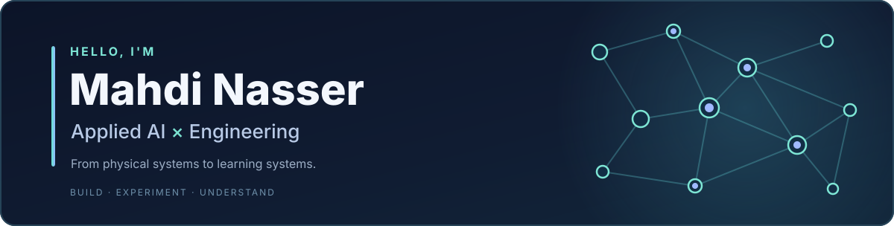
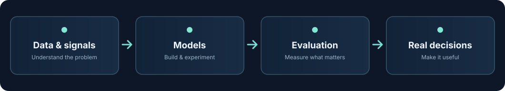

<!-- One subtle animation up front. Two colors keep it readable in GitHub light/dark mode. -->
<picture>
  <source media="(prefers-color-scheme: dark)" srcset="https://readme-typing-svg.demolab.com?font=Fira+Code&amp;weight=500&amp;size=19&amp;duration=2800&amp;pause=1050&amp;color=78DCD0&amp;center=true&amp;vCenter=true&amp;width=850&amp;height=54&amp;lines=Building+AI+systems+that+go+beyond+prediction;Deep+learning+%7C+LLMs+%7C+Agents+%7C+RL;From+physical+systems+to+learning+systems">
  
</picture>

[**Projects**](#-things-ive-built) · [**Currently building**](#-on-the-workbench) · [**How I think**](#-from-a-model-to-a-useful-system) · [**Say hello**](#-lets-connect)

## Hey, I'm Mahdi 👋

**I like building AI systems that do more than just make predictions.**

I'm pursuing an **M.Sc. in Cybernetics & Applied AI** at the University of Stavanger, with a bachelor's background in **Electronics & Automation**.

I started with control systems, embedded electronics, motors and sensors. Somewhere along the way, I became fascinated by how machines **learn, reason and make decisions**.

These days I spend a lot of time exploring **deep learning, LLMs, AI agents and reinforcement learning**. My favorite part isn't just getting something to work — it's finding out *why* it works, where it breaks, and what would make it better.

<strong>💬 A little more about how I got here</strong>

 

I used to spend my time tuning controllers and debugging physical systems. Now I also build learning systems — and debug models that can be confidently wrong.

I like projects that force me to go beyond calling an API: implement the underlying methods, question the evaluation, and connect the output to something meaningful.

## 🚀 Things I've built

| | Project | What made it interesting |
|:--:|---|---|
| 🔋 | **[BatterySwapAI 2026](https://github.com/rabrie10/BatterySwapAI2026-MR)** · *Predictive maintenance & optimization* | **Top 5** in a two-person competition team. Modelled stochastic battery degradation using ~8M IoT measurements, then connected failure-risk predictions to scheduling and route optimization. |
| 🧠 | **[Decoder-Only Transformer LLM](https://github.com/mahdinass/Decoder-Only-Transformer-LLM-standalone)** · *Deep learning fundamentals* | Built a character-level Transformer in PyTorch with causal attention, RMSNorm, KV caching, multiple decoding strategies and reproducible evaluations. Tested it against baselines instead of just showing generated samples. |
| 🚁 | **[Drone Flyby — Nordic AI Cup](https://github.com/rabrie10/Gforce-ai-cup-2026/tree/main/drone-flyby)** · *Computer vision & active perception* | Worked on a YOLO/DINOv2-based aerial detection pipeline with tracking and camera control. Investigated deployment failures and used domain randomization to improve detection on a small diagnostic set. |

<strong>🔎 Pick a rabbit hole — what would you like to explore?</strong>

 

- **Can ML predictions improve real operational decisions?** → [BatterySwapAI's case study](https://github.com/rabrie10/BatterySwapAI2026-MR/blob/main/docs/CASE_STUDY.md)
- **What's actually inside a language model?** → [Transformer architecture and implementation](https://github.com/mahdinass/Decoder-Only-Transformer-LLM-standalone/blob/main/docs/ARCHITECTURE.md)
- **What happens when a vision system fails outside its training distribution?** → [Drone Flyby experiments](https://github.com/rabrie10/Gforce-ai-cup-2026/tree/main/drone-flyby)

## 🧪 On the workbench

*A few projects I'm still experimenting with. I'll share them publicly when they're ready — no release dates promised.*

<strong>🧩 PEIS — An agent that investigates evidence, not just retrieves it</strong>

 

Building a provenance-aware AI system that can search technical evidence, investigate claims across sources, notice contradictions and report when the evidence is insufficient.

**Exploring:** Agentic reasoning · retrieval · structured memory · evidence verification · context-efficient LLM workflows.

**Status:** In active development. Public repository to follow.

<strong>🤖 Creature Forge — Can an AI learn from a robot falling?</strong>

 

Exploring a physics-grounded workflow where an AI proposes changes to simulated creatures, MuJoCo tests them, and explicit evaluation rules decide whether a proposed change actually helped.

**Exploring:** Physical AI · LLM-guided experimentation · physics simulation · controlled comparisons.

**Status:** Experimental project. Public release planned after further work.

<strong>🎮 Scaling Deep RL — What changes when neural networks get bigger?</strong>

 

Studying neural-network scale in deep reinforcement learning through controlled training experiments, repeatable runs and evaluation in simulated environments.

**Exploring:** Deep RL · network capacity · training stability · experimental design.

**Status:** Ongoing university team project; publication after completion and permission checks.

<strong>🎵 MusicCRS — Conversational music recommendations</strong>

 

Building a conversational music system that combines reliable catalog operations with natural-language interaction, contextual references and recommendation-oriented functionality.

**Exploring:** Conversational AI · retrieval · recommender systems · constrained LLM tool use.

**Status:** Ongoing university team project; publication after completion and permission checks.

## ⚙️ From a model to a useful system

I care about the full loop. A better metric is only interesting if it survives a meaningful evaluation — and a great model is even more interesting when it helps someone make a better decision.

That mindset comes partly from building physical systems, where the real world doesn't care how convincing a simulation looks.

## 🏭 AI outside the classroom

- **Lyse Energi · AI & Data Science Intern:** Built an electricity-forecasting and energy-insight proof of concept. Worked with a feature pipeline containing approximately **2.7 billion hourly records**, combining ML forecasts with peak, capacity and customer-cost analysis.
- **Petoro · AI & Digitalisation Intern:** Developed a Python pipeline to turn complex drilling-plan PDFs into structured operational data, using document layout, geometry and image processing.

<strong>🛠️ Technologies I keep reaching for</strong>

 

**ML & AI:** PyTorch, scikit-learn, Transformers, Hugging Face, time-series modelling, information retrieval, LLM tooling.

**Data & engineering:** Python, NumPy, Pandas, PySpark, Databricks, OpenCV, C/C++, MATLAB/Simulink.

**Things I enjoy working on:** Agents with verifiable reasoning, deep-learning architectures, reinforcement learning, evaluation that exposes failure modes, and ML for physical systems.

## 🤝 Let's connect

If you're working on an interesting AI/ML problem, have a research idea, or want to compare notes on an experiment that didn't behave as expected, I'd love to hear about it.

**[LinkedIn](https://www.linkedin.com/in/mahdi-nasser-aa6a0525a/)** · **[Email](mailto:mbnasser60@gmail.com)**

📍 Norway · M.Sc. expected 2027 · This page is a work in progress, just like the projects.
