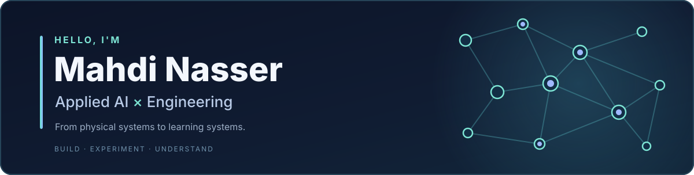
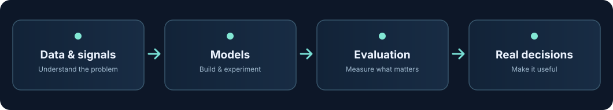

<!-- One subtle animation up front. Two colors keep it readable in GitHub light/dark mode. -->
<picture>
  <source media="(prefers-color-scheme: dark)" srcset="https://readme-typing-svg.demolab.com?font=Fira+Code&amp;weight=500&amp;size=19&amp;duration=2800&amp;pause=1050&amp;color=78DCD0&amp;center=true&amp;vCenter=true&amp;width=850&amp;height=54&amp;lines=Building+AI+systems+that+go+beyond+prediction;Deep+learning+%7C+LLMs+%7C+Agents+%7C+RL;From+physical+systems+to+learning+systems">
  
</picture>

[**Projects**](#-things-ive-built) · [**Currently building**](#-on-the-workbench) · [**How I think**](#-from-a-model-to-a-useful-system) · [**Say hello**](#-lets-connect)

## Hey, I'm Mahdi 👋

**I like building AI systems that do more than just make predictions.**

I'm pursuing an **M.Sc. in Cybernetics & Applied AI** at the University of Stavanger, with a bachelor's background in **Electronics & Automation**.

I started with control systems, embedded electronics, motors and sensors. Somewhere along the way, I became fascinated by how machines **learn, reason and make decisions**.

These days I spend a lot of time exploring **deep learning, computer vision, LLM agents and reinforcement learning**. My favorite part isn't just getting something to work — it's finding out *why* it works, where it breaks, and what would make it better.

<strong>💬 A little more about how I got here</strong>

 

I used to spend my time tuning controllers and debugging physical systems. Now I also build learning systems — and debug models that can be confidently wrong.

I like projects that force me to go beyond calling an API: implement the underlying methods, question the evaluation, and connect the output to something meaningful.

## 🚀 Things I've built

  
   
  Featured: <a href="https://github.com/mahdinass/Creature-Forge">Creature Forge</a> · <a href="https://youtu.be/hPY-_cK5Oow">Watch the demonstration</a> · Recorded simulation, separate seed panels.

| | Project | What made it interesting |
|:--:|---|---|
| 🤖 | **[Creature Forge](https://github.com/mahdinass/Creature-Forge)** · *Physical AI & LLM agents* | Built a MuJoCo robotics lab where NVIDIA Nemotron investigates failures, requests physics experiments and proposes bounded redesigns. Independent simulation verifies changes. In one live demo, an accepted redesign went from **0/8 to 8/8** push tests on separate seed panels. [Demo](https://youtu.be/hPY-_cK5Oow) · [Evidence](https://github.com/mahdinass/Creature-Forge#what-was-demonstrated-and-how-strongly). |
| 🚁 | **[Drone Flyby](https://github.com/mahdinass/Drone-Flyby-Active-Vision)** · *Active vision · Nordic AI Cup 2026* | Built the perception and camera-control pipeline for our team entry using YOLO11s, DINOv2 and full-frame tracking. After retraining with domain randomization, proposals matching annotated targets at IoU ≥ 0.50 rose from **3/14 to 13/14** in an offline diagnostic replay. |
| 🩻 | **[Explainable Stroke Outcome Prediction](https://github.com/mahdinass/ELE630-Stroke-XAI-Public)** · *3D medical imaging · ELE630 team research* | Co-developed models for 90-day stroke outcomes using admission CT and clinical features. Evaluated Grad-CAM and HiResCAM against matched random perturbations. The clinical-only baseline had the highest AUROC on the **28-patient internal holdout**. |

### Browse by topic

<strong>Agents &amp; LLMs</strong>

- **[Creature Forge](https://github.com/mahdinass/Creature-Forge)**. An LLM agent investigates robot failures, requests MuJoCo experiments and proposes redesigns.
- **[MusicCRS](https://github.com/mahdinass/MusicCRS)** · *Conversational AI & recommender systems*. Built a music-discovery workspace with catalog-grounded search, listening-context and feedback-aware ranking, and natural-language playlist controls. An optional, bounded LLM planner uses validated Python tools for state changes; preferences are only persisted with explicit approval. [Architecture](https://github.com/mahdinass/MusicCRS/blob/main/docs/architecture.md).
- **[Decoder-Only Transformer LLM](https://github.com/mahdinass/Decoder-Only-Transformer-LLM-standalone)** · *Deep learning fundamentals*. Built a character-level Transformer in PyTorch with causal attention, RMSNorm, KV caching, multiple decoding strategies and reproducible evaluations. Tested it against baselines instead of just showing generated samples. [Model architecture](https://github.com/mahdinass/Decoder-Only-Transformer-LLM-standalone/blob/main/docs/ARCHITECTURE.md).
- **[FakeTT — Multimodal Misinformation Detection](https://github.com/mahdinass/FakeTT-Multimodal-LLM-Research)** · *Multimodal LLMs & evaluation*. Led the text-classifier baseline and data-quality audits; worked with teammates on System 2 and developed the selected Prompt C + dynamic five-shot strategy. Fake-news recall rose from **66.7% to 75.0%** on a 74-video test split, with precision trade-offs clearly documented. [Results and ablations](https://github.com/mahdinass/FakeTT-Multimodal-LLM-Research#recorded-test-results).

<strong>Computer Vision &amp; Medical AI</strong>

- **[Drone Flyby](https://github.com/mahdinass/Drone-Flyby-Active-Vision)**. Aerial object detection with active camera control. [Pipeline diagram](https://github.com/mahdinass/Drone-Flyby-Active-Vision#from-pixels-to-the-next-view).
- **[ELE630 Stroke XAI](https://github.com/mahdinass/ELE630-Stroke-XAI-Public)**. 3D CT modelling, explanation methods and a clinical baseline. [Held-out results](https://github.com/mahdinass/ELE630-Stroke-XAI-Public#results-development-versus-final-internal-test).

<strong>RL &amp; Optimization</strong>

- **[Scaling Deep RL](https://github.com/mahdinass/ele680-scaling-drl)** · *Soft Actor-Critic · team research*. Compared **8 network architectures** across **24 one-million-step HalfCheetah-v5 runs** (three seeds each), isolating width, depth, normalization and residual connections. Published reproducible analysis and limitations, without claiming a general scaling law. [Results](https://github.com/mahdinass/ele680-scaling-drl#results-at-a-glance).
- **[BatterySwapAI 2026](https://github.com/rabrie10/BatterySwapAI2026-MR)** · *Predictive maintenance & optimization*. **Top 5** in a two-person competition team. Modelled stochastic battery degradation using ~8M IoT measurements, then connected failure-risk predictions to scheduling and route optimization. [Case study](https://github.com/rabrie10/BatterySwapAI2026-MR/blob/main/docs/CASE_STUDY.md).

## 🧪 On the workbench

*Projects still in development or not yet released publicly.*

<strong>🧩 PEIS — An agent that investigates evidence, not just retrieves it</strong>

 

Building a provenance-aware AI system that can search technical evidence, investigate claims across sources, notice contradictions and report when the evidence is insufficient.

**Exploring:** Agentic reasoning · retrieval · structured memory · evidence verification · context-efficient LLM workflows.

**Status:** In active development. Public repository to follow.

## ⚙️ From a model to a useful system

I care about the full loop. A better metric is only interesting if it survives a meaningful evaluation — and a great model is even more interesting when it helps someone make a better decision.

That mindset comes partly from building physical systems, where the real world doesn't care how convincing a simulation looks.

## 🏭 AI outside the classroom

- **Lyse Energi · AI & Data Science Intern:** Built an electricity-forecasting and energy-insight proof of concept. Worked with a feature pipeline containing approximately **2.7 billion hourly records**, combining ML forecasts with peak, capacity and customer-cost analysis.
- **Petoro · AI & Digitalisation Intern:** Developed a Python pipeline to turn complex drilling-plan PDFs into structured operational data, using document layout, geometry and image processing.

<strong>🛠️ Technologies I keep reaching for</strong>

 

**ML & AI:** PyTorch, scikit-learn, Transformers, Hugging Face, time-series modelling, information retrieval, LLM tooling.

**Data & engineering:** Python, NumPy, Pandas, PySpark, Databricks, OpenCV, C/C++, MATLAB/Simulink.

**Things I enjoy working on:** Agents with verifiable reasoning, deep-learning architectures, reinforcement learning, evaluation that exposes failure modes, and ML for physical systems.

## 🤝 Let's connect

If you're working on an interesting AI/ML problem, have a research idea, or want to compare notes on an experiment that didn't behave as expected, I'd love to hear about it.

**[LinkedIn](https://www.linkedin.com/in/mahdi-nasser-aa6a0525a/)** · **[Email](mailto:mbnasser60@gmail.com)**

📍 Norway · M.Sc. expected 2027 · This page is a work in progress, just like the projects.
